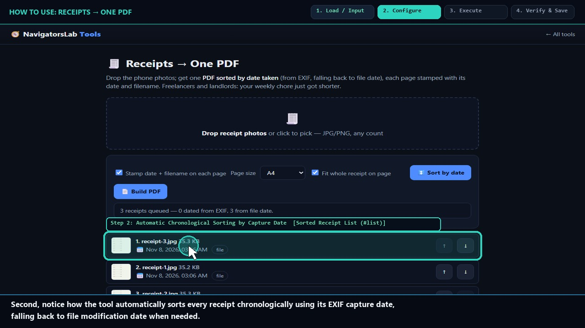
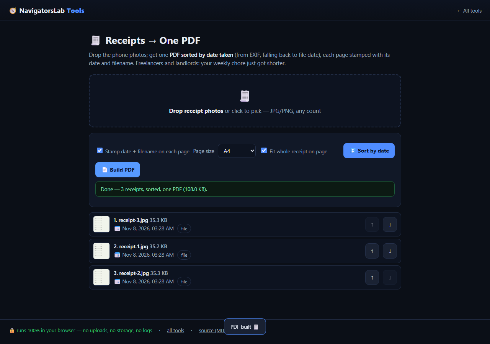

# 🧾 Receipts → One PDF

> Shoebox of receipt photos → one date-sorted PDF

     

<h4 align="center">
  &#9654; <a href="https://navigatorslab.com/tools/receipts.html">Open it on navigatorslab.com</a> &mdash; free, no sign-up, nothing uploaded<br>
  <a href="https://navigatorslab.com/Receipts-to-PDF">navigatorslab.com/Receipts-to-PDF</a> &middot; <a href="https://navigatorslab.com/tools/videos/receipts.mp4">🔊 Watch Narrated Step-by-Step Tutorial Video</a> &middot; <a href="https://navigatorslab.com/tools/videos/notebooklm-overview.mp4">Watch Full Suite Hands-On Video</a><br>
  This repo's Pages site runs the <em>actual tool</em>: <code>demo.html</code>
</h4>



Sorted by EXIF date taken, each page stamped with date and filename. Freelancers and landlords: weekly chore, gone.

## 📖 Complete Step-by-Step User Guide

### Step 1: Drop a Batch of Receipt Photos (`Receipt Dropzone (#dz)`)
- **How to do it:** Select or drag a batch of receipt photos (`.jpg`, `.png`, `.webp`) onto `#dz`.
- **Expected result:** All receipts load into the workspace and EXIF timestamps are parsed automatically.

### Step 2: Automatic Chronological Sorting by Capture Date (`Sorted Receipt List (#list)`)
- **How to do it:** Inspect the ordered list in `#list`. Receipts are sorted oldest-to-newest by their EXIF `DateTimeOriginal` tag so your expense packet follows your trip timeline.
- **Expected result:** Receipts are ordered chronologically without manual renaming.

### Step 3: Rotate Sideways Receipts or Reorder Rows (`Row Controls in #list`)
- **How to do it:** Use the per-row controls in `#list` to rotate sideways photos 90° or remove duplicate shots before exporting.
- **Expected result:** Every receipt is upright and properly sequenced.

### Step 4: Build One Stamped Multi-Page Expense PDF (`Build Stamped PDF Button (#pdf)`)
- **How to do it:** Click **Build 1 stamped PDF (`#pdf`)**. `pdf-lib` lays out one receipt per page with a top audit header (`#1 · YYYY-MM-DD · filename.jpg`).
- **Expected result:** A single, accountant-ready expense report PDF downloads to your device.

## 🎛️ UI Controls, Shortcuts & Parameters Reference

| Control / Shortcut | What It Does |
|---|---|
| `Batch Dropzone (`#dz`)` | Accepts dozens of JPEG, PNG, or WebP receipt photos in one drop. |
| `Chronological List (`#list`)` | Displays each receipt's detected EXIF date, dimensions, and page order. |
| `Build 1 stamped PDF (`#pdf`)` | Generates a single multi-page PDF with audit headers stamped at the top of every page. |

## 💡 Pro Tips & Real-World Workflows

- 💡 Take receipt photos with your phone camera (which embeds `DateTimeOriginal`) so multi-day business trip receipts sort themselves automatically.
- 💡 Pair this tool with **Receipt OCR to CSV (`ocr.html`)**: use `receipts.html` for the visual PDF attachment and `ocr.html` for the spreadsheet line items.
- 💡 All EXIF GPS coordinates from the original receipt photos are left out of the newly built PDF pages.

## 🧪 Concrete Example: Input → Engine → Output

| Stage | What Happens | Details |
|---|---|---|
| **1. Raw Input** | **18 Unsorted Receipt Photos from Camera Roll** | IMG_4019.jpg (Sep 12), IMG_3902.jpg (Sep 03), IMG_4110.jpg (Sep 19) — out of chronological order |
| **2. On-Device Engine** | **Extracts EXIF DateTimeOriginal per photo, sorts chronologically, and stamps header with capture date + filename** | Runs 100% client-side in your browser tab under strict `CSP` (`connect-src 'none'`). |
| **3. Verified Output** | **2026-Q3-Receipts-Sorted.pdf** | 18 pages ordered Sep 03 → Sep 19, every page stamped '2026-09-03 · IMG_3902.jpg' at top margin |

```text
Page 1: 2026-09-03 | Page 2: 2026-09-12 | Page 3: 2026-09-19 | Stamped & Merged [OK]
```

- 🔊 **Narrated Step-by-Step Usage Tutorial Video (`36s`):** [`demo.mp4`](./demo.mp4) (also live at [`https://navigatorslab.com/tools/videos/receipts.mp4`](https://navigatorslab.com/tools/videos/receipts.mp4))
- 🎬 **Full Suite Hands-On Video Guide:** [`https://navigatorslab.com/tools/videos/notebooklm-overview.mp4`](https://navigatorslab.com/tools/videos/notebooklm-overview.mp4)

## ✅ What it does

- Stack receipt photos into one tidy, print-ready PDF
- Ordered by EXIF date taken; rotate and re-shoot pages before export
- Every page stamped with date and filename — expense reports, done

## 🚀 Try it in 30 seconds

1. Drop the shoebox of receipt photos
2. They sort themselves by EXIF date — rotate if needed
3. Export one stamped PDF

## 📸 Live UI in action



## 🔒 Private by design

- **100% on-device** — files are processed in your browser and **never uploaded** to any server
- **No accounts, no tracking, no cookies, nothing retained** — open the page and work
- **Works offline** once loaded; fully mobile-friendly
- **Free & open source (MIT)** — use it at home, at work, anywhere

## 🤖 Built for humans *and* AI agents

- Deep-linkable via URL parameters — see the [Agent Mode guide](https://navigatorslab.com/tools/agents.html)
- Machine-readable catalog: [llms.txt](https://navigatorslab.com/tools/llms.txt) · [llms-full.txt](https://navigatorslab.com/tools/llms-full.txt)
- MCP endpoint: `POST https://navigatorslab.com/tools/mcp` (tool catalog + deterministic text tools — see the [main repo](https://github.com/Kayforkind/NavigatorsLab-Tools))
- No build step required to *use* any tool — just the URL

## 🛠 Under the hood

EXIF capture-date extraction + pdf-lib, one stamped page per receipt

Third-party components are catalogued in [NOTICE](NOTICE); this repo is MIT-licensed ([LICENSE](LICENSE)).

## 🗂 The NavigatorsLab Tools suite

The full catalog — every tool in the hub with the same zero-upload promise, plus the lab's apps, CLIs and engines:

| Tool | What it does | |
|---|---|---|
| 🛡 Photo Privacy Kit | Strip GPS, camera model and timestamps before posting | [Open](https://navigatorslab.com/tools/exif.html) |
| 🔐 Password Breach Checker | Has this password been breached? — it never leaves your tab | [Open](https://navigatorslab.com/tools/breachcheck.html) |
| 🔍 Metadata & Hidden-Data Checker | See what's really inside a file — then strip it | [Open](https://navigatorslab.com/tools/metadata.html) |
| 🗜 Image Shrinker | Hit “max 2 MB” portal limits without TinyPNG | [Open](https://navigatorslab.com/tools/shrink.html) |
| 📄 Scan & Screenshot Cleaner | Phone photos of documents → clean, straight PDFs | [Open](https://navigatorslab.com/tools/scan.html) |
| ✍ Local E-Sign Pad | Sign this lease tonight — not DocuSign | [Open](https://navigatorslab.com/tools/sign.html) |
| **🧾 Receipts → One PDF** | Shoebox of receipt photos → one date-sorted PDF | [Open](https://navigatorslab.com/tools/receipts.html) |
| 🔢 Receipt OCR → CSV | Read totals off receipt photos, export for expenses | [Open](https://navigatorslab.com/tools/ocr.html) |
| 🔳 QR Studio | Generate QR codes and decode QR images — no site sees them | [Open](https://navigatorslab.com/tools/qr.html) |
| 🎧 Audio Trimmer | Cut voice notes and clips on a waveform | [Open](https://navigatorslab.com/tools/audio.html) |
| 🧮 Invoice / Quote Generator | One-person shops: hours in, clean PDF out | [Open](https://navigatorslab.com/tools/invoice.html) |
| 🗂 Batch Rename & Sort | IMG_5847.jpg → 2026-09-05-receipt-home-depot.jpg | [Open](https://navigatorslab.com/tools/rename.html) |
| 🖨 Print-Shop Prep | Exact sizes, bleed, DPI checks, print-ready PDF | [Open](https://navigatorslab.com/tools/printprep.html) |
| 📑 PDF Pages | Reorder, rotate, delete and extract PDF pages | [Open](https://navigatorslab.com/tools/pdfpages.html) |
| 🔬 Text Diff | Compare two texts with word-level highlights | [Open](https://navigatorslab.com/tools/textdiff.html) |
| 🎨 Reimagine | Redesign any HTML page from its own content | [Open](https://navigatorslab.com/reimagine/) |
| 📊 Text Stats | Words, reading time, readability, keyword density | [Open](https://navigatorslab.com/tools/textstats.html) |
| 📜 PDF Studio | Edit the text inside your PDF — private, free, open source | [Open](https://navigatorslab.com/pdf-studio/) |
| 🩺 Design Health | 18 deterministic design-quality checks for HTML — no LLM, no API key | [Open](https://github.com/Kayforkind/design-health-action) |
| 🔪 Skill Slice | Copy one Read-verified skill folder — a slice, not the pie | [Open](https://github.com/Kayforkind/skill-slice) |
| 🕵 liecatchers | Your agent said Done. Prove it — ten sensors, one RECEIPT.json | [Open](https://github.com/Kayforkind/liecatchers) |
| 📚 Book Guide MCP | Ship improvements with your books — agents cite, run playbooks, learn | [Open](https://github.com/Kayforkind/book-guide-mcp) |
| 📡 Data Insights | Founder intelligence — daily & weekly tech signal briefs | [Open](https://github.com/Kayforkind/data-insights) |
| 🪓 Iron Axe: Legacy | An original side-scrolling beat 'em up — Godot 4 | [Open](https://github.com/Kayforkind/iron-axe-legacy) |

---

<p align="center">
  <b>One hub, twenty-four projects:</b> <a href="https://navigatorslab.com/tools/">https://navigatorslab.com/tools</a><br>
  <b>Source &amp; the whole suite:</b> <a href="https://github.com/Kayforkind/NavigatorsLab-Tools">https://github.com/Kayforkind/NavigatorsLab-Tools</a>
</p>
